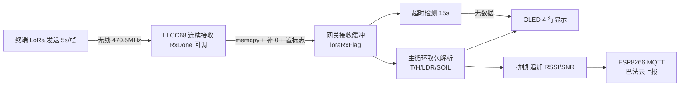

## 产品概述

将 `STM32_Gateway_PROJECT` 由当前的"终端节点"改造为"LoRa 网关节点"：不再采集本地传感器，专职接收终端通过 LoRa 发来的环境数据帧，解析后在 OLED 上显示，并转发到巴法云 MQTT 平台，同时具备链路超时告警能力。

## 核心功能

- **LoRa 接收**：以连续接收（Rx Continuous）方式常驻监听，非阻塞接收终端每 5 秒发来的一帧数据（`T=25.6C,H=60.2%,LDR=1200,SOIL=3400`），记录信号强度 RSSI 与信噪比 SNR
- **OLED 显示**（英文/数字，4 行，每行 16 字符）：
- 第 1 行：`T:25.6C H:60.2%`（空气温湿度）
- 第 2 行：`L:1200 S:3400`（光照与土壤湿度）
- 第 3 行：`MQ:OK LORA:OK`（MQTT 与 LoRa 模块状态，异常显示 NG）
- 第 4 行：`STATUS:ALL OK` / `STATUS:PART FAIL` / `STATUS:FAIL`（总状态）
- **MQTT 上报**：上电连接巴法云（ESP8266 连热点 -> MQTT 连接 -> 订阅主题），每收到一帧即发布，内容为终端原帧追加链路质量：`T=..C,H=..%,LDR=..,SOIL=..,RSSI=-45,SNR=10`；掉线后按最小间隔自动重连
- **链路超时告警**：超过约 15 秒未收到任何数据，OLED 首行显示 `NO DATA`，数据行显示 `--`，总状态置为 FAIL
- **移除本地采集**：删除 DHT22 温湿度、光照与土壤湿度的采集与 LoRa 发送逻辑（驱动文件与初始化保留，仅不调用）
- **不做**：LED 收包指示、接收包计数、OLED 上的 RSSI/SNR 显示、下行控制
- **约束**：`STM32_Terminal_PROJECT` 任何文件不得修改

## 技术栈

- MCU：STM32F103C8（HAL 库），IDE/编译器：Keil MDK（工程 `MDK-ARM\STM32_PROJECT.uvprojx`，UV4 位于 `D:\keil_v5`）
- LoRa：LLCC68（Semtech radio.c 驱动移植，SPI1）
- 显示：0.96 寸 I2C OLED（`OLED_ShowString`，页地址 0/2/4/6，字模仅 11 个汉字，故全英文显示）
- 联网：ESP8266（USART2，空闲中断接收）+ 巴法云 MQTT
- 调试日志：USART1（printf 已重定向）

## 实现方案

采用**事件驱动 + 非阻塞轮询**架构：把现有阻塞的 `ExampleLLCC68ReciveDemo()` 死循环，改造成与发送侧对称的非阻塞接收接口（参考 `llcc68_example_send.c` 已有的 `LLCC68_RadioInit / LLCC68_SendPacket / LLCC68_IrqProcess` 风格，保持工程风格一致）。

**关键决策与权衡**：

1. **连续接收（Rx Continuous）而非单次接收**：`SetRxConfig` 末位 `rxContinuous=true` + `Radio.Rx(0)`。依据 radio.c 已核实行为——`RxDone` 后驱动不会自动重启 RX，只有 `RxContinuous==true` 时硬件才保持监听；若沿用单次模式则每次回调都要 `Standby()+Rx()` 重启，存在重启间隙漏包且代码更复杂。因此选连续接收，且**回调内不得调用 `Radio.Standby()`/`Radio.Rx()`**（现有示例回调里写了，必须删掉，否则打断持续监听）。
2. **RxDone 回调内立即拷贝数据**：`RadioRxPayload[255]` 是 radio.c 全局缓冲，下一包直接覆盖，必须在回调中 memcpy 到网关自有缓冲并记录 `size/rssi/snr`，仅置标志位，不做耗时操作（不在回调里刷 OLED / 发 MQTT）。
3. **手动补字符串结尾**：终端（禁止修改）以 `strlen` 长度发送、不含 `'\0'`，网关必须按 `size` 拷贝后补 `'\0'`，否则 `sscanf`/`%s` 会越界读到乱码。
4. **RadioEvents 单例互斥**：`llcc68_example_send.c` 与 `llcc68_example_recive.c` 各有 `static RadioEvents_t` 且都调用 `Radio.Init()`，radio.c 仅一个全局 `RadioEvents` 指针，后初始化者覆盖前者。网关 main **只调用接收侧初始化**，删除对 send 侧 `LLCC68_RadioInit()` 的调用（否则接收回调失效）。
5. **事件驱动上报**：收到一帧即解析、刷 OLED、发 MQTT（不是定时 5 秒周期），与终端 5 秒发送节奏天然同频，避免无谓刷新与空转。
6. **阻塞风险可控**：`ESP_Init`/`MQTT_Connect` 为阻塞式 AT 等待，重连瞬间主循环暂停、`Radio.IrqProcess` 停摆，可能丢 1 包；由 30 秒最小重连间隔 + 15 秒超时告警兜底，代价可接受。

## 实现要点（防回归）

- 接收缓冲与 MQTT 上报缓冲分离：接收缓冲 ≥ 64 字节（按 `size` 拷贝 + 补零），上报缓冲 ≥ 128 字节（原帧约 35 字节 + `,RSSI=-45,SNR=10`）
- 解析用 `sscanf` 严格匹配终端格式 `T=%fC,H=%f%%,LDR=%d,SOIL=%d`，解析失败计入"部分失败"，不得用解析失败值刷新显示
- 保留 `MX_ADC1_Init`、`HAL_TIM_Base_Start(&htim2)`、`HAL_UARTEx_ReceiveToIdle_IT(&huart2,...)` 等已有初始化，不回退已修复的 usart.c / adc.c / soil.c
- 日志沿用 printf（USART1），每包打印 `[LoRa]RX len/rssi/snr` 与 `[MQTT]publish ok/fail`，避免高频刷屏
- 超时阈值取 15 秒（终端 5 秒一包，留 3 倍余量），用 `HAL_GetTick()` 差值判断，仅状态变化时刷新 OLED，避免重复清屏闪烁

## 架构设计

网关数据流：



## 目录结构

本次仅修改 `D:\MCU\STM32_PROJECT\STM32_Gateway_PROJECT` 下 3 个文件：

```
STM32_Gateway_PROJECT/
├── Core/
│   ├── Inc/
│   │   └── llcc68_example_recive.h   # [MODIFY] 新增非阻塞接收接口声明（LLCC68_RecvInit / LLCC68_RecvIrqProcess / LLCC68_RecvGetPacket）与新包标志 extern 声明；保留原有 ExampleLLCC68ReciveDemo 声明不破坏。
│   └── Src/
│       ├── llcc68_example_recive.c   # [MODIFY] 改造为连续接收实现：注册回调（RxDone/RxTimeout/RxError）+ SetRxConfig(rxContinuous=true) + Radio.Rx(0)；RxDone 内仅做 memcpy、补 '\0'、记录 size/rssi/snr、置 loraRxFlag，删除原 Standby+Rx 重启；RxTimeout/RxError 做自恢复与计数打印。
│       └── main.c                    # [MODIFY] 改写为网关主逻辑：移除 DHT22/ADC 采集与 LoRa 发送；初始化 OLED/LoRa 连续接收/巴法云 MQTT；主循环高频 LLCC68_RecvIrqProcess()，取到新包后解析 -> 刷 OLED -> MQTT 上报（原帧+RSSI/SNR）；实现 15 秒链路超时告警与 MQTT 掉线重连。
└── MDK-ARM/
    └── STM32_PROJECT.uvprojx         # [验证用] Keil 工程，仅用于命令行编译验证，不修改工程配置
```

## 关键代码结构

`Core\Inc\llcc68_example_recive.h` 中新增的接口契约（main.c 与接收实现共同依赖）：

```c
/* 非阻塞接收接口，供 main.c 业务主循环调用（与 llcc68_example_send.h 风格对称） */
void    LLCC68_RecvInit(void);                                          // 注册回调 + 配置射频 + 进入连续 RX
void    LLCC68_RecvIrqProcess(void);                                    // 主循环高频调用：Radio.IrqProcess()
uint8_t LLCC68_RecvGetPacket(char *buf, uint8_t bufLen,
                             int16_t *rssi, int8_t *snr);               // 取出一包（自动清零标志），返回数据长度，0 表示无新包；buf 内含 '\0' 结尾

extern volatile uint8_t loraRxFlag;                                     // 1 = 收到新包待 main 取走
```

## Agent Extensions

### SubAgent

- **code-explorer**
- Purpose：实现前核对 `Core\Src\radio.c`（`Radio.Init` / `SetRxConfig` / `RadioRx` / `RadioIrqProcess` 的调用点与全局 `RadioEvents` 赋值）与 `Core\Src\mqtt.c`（`ESP_Init` / `MQTT_Connect` / `MQTT_Publish` 的实现是否依赖 `wifi_rxflag`、`wifi_rxbuf` 及阻塞时长），确认网关改造不会与驱动内部状态冲突。
- Expected outcome：得到 radio 初始化与 IRQ 处理的准确调用链、MQTT 各函数的依赖与阻塞范围，确保接收接口与 main.c 改动一次成型、不破坏底层驱动。