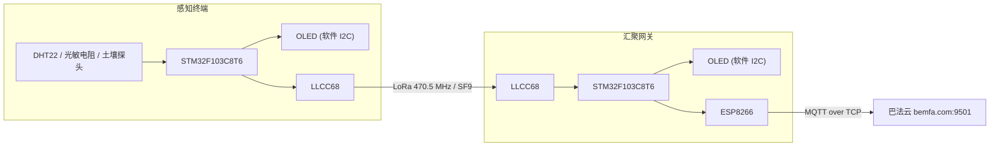

# 基于 STM32 + LoRa 的农业环境监测系统

基于 STM32F103C8T6 的"感知终端 + 汇聚网关"两级农业环境监测系统。终端周期性采集空气温湿度、光照与土壤湿度，经 470 MHz LoRa 上传；网关常驻接收、本地 OLED 显示，并通过 ESP8266 转发至巴法云 MQTT，实现远程监测。

## 功能特性

**感知终端（STM32_Terminal_PROJECT）**

- DHT22 单总线采集空气温湿度，校验和 + 超时双保护
- 光敏电阻（PA0）与土壤湿度探头（PA1）双路 ADC 采集
- 5 秒周期采集 → 组帧 → LoRa 发送 → OLED 刷新
- OLED 本地显示采集值与"全部正常 / 部分失败 / 失败"三级状态
- 异常处理：ADC 值域过滤（0/4095 判未接或短路）、采集失败显示 `--`

**汇聚网关（STM32_Gateway_PROJECT）**

- LLCC68 连续接收（RxContinuous），非阻塞轮询处理 DIO1 中断
- 解析终端数据帧，OLED 显示温湿度、光照、土壤及模块状态
- ESP8266 AT 透传 + 手工构造 MQTT 报文，转发至巴法云
- 上报内容在终端原帧后追加链路质量：`RSSI` / `SNR`
- 15 秒链路超时告警（OLED 显示 `NO DATA` 并置 FAIL），MQTT 掉线 30 秒节流重连

## 系统架构



## 硬件说明

| 模块  | 型号 / 参数 | 接口  |
| --- | --- | --- |
| 主控  | STM32F103C8T6（Cortex-M3，中密度），72 MHz | —   |
| 温湿度 | DHT22 | 单总线，PC15 |
| 光照  | 光敏电阻 + 分压电路 | ADC1_IN0，PA0 |
| 土壤湿度 | 电阻式土壤探头 + 分压电路 | ADC1_IN1，PA1 |
| LoRa | LLCC68 | SPI1：SCK=PA5 / MISO=PA6 / MOSI=PA7 / NSS=PA4；BUSY=PB0；RESET=PB1；DIO1=PB10 |
| OLED | SSD1306 128×64 | 软件模拟 I2C：SCL=PB6 / SDA=PB7 |
| WiFi | ESP8266 | USART2：TX=PA2 / RX=PA3，115200 |
| 调试串口 | —   | USART1：TX=PA9 / RX=PA10，115200 |
| 下载调试 | ST-Link / DAP-Link | SWD：PA13 / PA14 |

时钟配置：HSE + PLL ×9 → SYSCLK 72 MHz，APB1 36 MHz，APB2 72 MHz，ADC 时钟 = PCLK2 / 6 = 12 MHz。

## 通信协议

### LoRa 数据帧

终端以 ASCII 键值对组帧，字段用 `,` 分隔，**发送长度为 `strlen`，不含结尾 `'\0'`**：

```
T=25.6C,H=60.2%,LDR=1200,SOIL=3400
```

| 字段  | 含义  | 单位  |
| --- | --- | --- |
| T   | 空气温度 | ℃   |
| H   | 空气湿度 | %RH |
| LDR | 光照 ADC 原始值 | 0~4095 |
| SOIL | 土壤湿度 ADC 原始值 | 0~4095 |

网关解析后转发至云端时追加信号质量：

```
T=25.6C,H=60.2%,LDR=1200,SOIL=3400,RSSI=-45,SNR=10
```

> 注意：接收端必须按实际长度拷贝并补 `'\0'`，不可直接把 payload 当字符串使用。

### 射频参数

| 参数  | 值   |
| --- | --- |
| 频率  | 470.5 MHz |
| 扩频因子 | SF9 |
| 带宽  | 125 kHz |
| 编码率 | 4/5 |
| 前导码 | 8   |
| 发射功率 | 22 dBm |
| CRC | 开启  |

### MQTT

- 服务器：`bemfa.com`，端口 `9501`
- 传输：ESP8266 AT 透传，MCU 侧手工构造 CONNECT / SUBSCRIBE / PUBLISH 报文
- 上报 QoS：QoS0（不等应答）
- 客户端 ID：巴法云私钥

## 目录结构

```
STM32_PROJECT/
├── README.md
├── STM32_Terminal_PROJECT/              # 感知终端工程
│   ├── Core/
│   │   ├── Inc/                         # 各模块头文件
│   │   └── Src/
│   │       ├── main.c                   # 终端主循环：采集 → 组帧 → LoRa 发送 → OLED
│   │       ├── adc.c / soil.c           # ADC 初始化、双通道单次采集
│   │       ├── oled.c                   # SSD1306 驱动 + 软件 I2C
│   │       ├── mqtt.c                   # ESP8266 AT + MQTT 报文（终端侧当前未启用）
│   │       ├── llcc68_example_send.c    # LoRa 非阻塞发送接口
│   │       ├── llcc68.c / radio.c       # Semtech 官方 LLCC68 / radio 驱动
│   │       └── LLCC68STM32F103-board.c  # 板级移植层（SPI / GPIO / 软定时器）
│   ├── MDK-ARM/dht22.c                  # DHT22 单总线驱动
│   ├── MDK-ARM/STM32_PROJECT.uvprojx    # Keil 工程
│   └── STM32_PROJECT.ioc                # CubeMX 工程
└── STM32_Gateway_PROJECT/               # 汇聚网关工程（结构同终端）
    ├── Core/Src/main.c                  # 网关主循环：接收 → 解析 → OLED → MQTT
    ├── Core/Src/llcc68_example_recive.c # LoRa 连续接收接口
    └── MDK-ARM/STM32_PROJECT.uvprojx    # Keil 工程
```

## 快速开始

### 开发环境

- STM32CubeMX 6.16 + STM32Cube FW_F1 V1.8.7
- Keil MDK-ARM V5.32（ARMCC V5.06）
- 硬件：两块 STM32F103C8T6 最小系统板、两个 LLCC68 模块、一个 ESP8266、一个 OLED、DHT22、光敏电阻、土壤湿度探头

### 编译

用 Keil 打开对应工程（`MDK-ARM/STM32_PROJECT.uvprojx`），直接 Build。也可命令行编译：

```bat
UV4.exe -j0 -b STM32_Terminal_PROJECT\MDK-ARM\STM32_PROJECT.uvprojx -o build.log
UV4.exe -j0 -b STM32_Gateway_PROJECT\MDK-ARM\STM32_PROJECT.uvprojx -o build.log
```

### 烧录与运行

1. 终端与网关分别烧录各自工程（SWD）。
2. 上电后终端显示 `AGRI MONITOR`，网关显示 `LORA GATEWAY`。
3. 网关先连接 WiFi 与巴法云（OLED 显示 `WIFI CONNECT`），再进入 LoRa 连续接收。
4. 终端每 5 秒发送一帧，网关解析后刷新 OLED 并上报云端。
5. 超过 15 秒未收到数据，网关 OLED 显示 `NO DATA`、状态置 `FAIL`。

### 配置修改

| 配置项 | 文件  | 说明  |
| --- | --- | --- |
| WiFi 账号密码 | `Core/Inc/mqtt.h` | `WIFI_SSID` / `WIFI_PASSWD` |
| 巴法云主题 | `Core/Inc/mqtt.h` | `TOPIC` |
| 巴法云私钥 | `Core/Inc/mqtt.h` | `USER_KEY`（同时作为 MQTT clientid） |
| LoRa 射频参数 | `Core/Inc/project_config.h` | 频率 / 扩频因子 / 带宽 / 编码率 / 发射功率 |

> 终端与网关的 LoRa 参数必须保持一致，否则无法通信。

## 工作流程

**终端**

```
上电 → 外设初始化 → OLED 开机画面 → TIM2 启动 → LoRa 发送初始化
主循环：
  ├─ 每轮：LLCC68_IrqProcess()
  └─ 每 5 s：DHT22_GetVal → SOIL_GetValue → 组帧
             → LLCC68_SendPacket → OLED 刷新状态
```

**网关**

```
上电 → OLED → UART2 空闲中断 → ESP_Init / MQTT 连接订阅 → LoRa 连续接收
主循环：
  ├─ LLCC68_RecvIrqProcess()
  ├─ 收到新包 → 解析 T/H/LDR/SOIL → OLED → MQTT 上报（原帧 + RSSI/SNR）
  ├─ 15 s 无数据 → OLED 显示 NO DATA，状态 FAIL
  └─ MQTT 掉线 → 30 s 节流重连
```

## 关键实现说明

1. **ADC 双通道采集**：STM32F103C8 属中密度器件，`ADC_CR2.EOCS` 位无效。扫描模式在非 DMA 下 EOC 只在整个序列结束时置位，逐通道读取会得到同一个值。因此采用单通道动态切换 + 单次转换，并选用 239.5 周期长采样应对高阻抗传感器，上电做一次 ADC 校准。
2. **LoRa 非阻塞收发**：把官方阻塞示例改造为 `Init / Poll / Send / GetPacket` 接口。发送用 `loraTxDone` 忙标志；接收端使用 RxContinuous + `Radio.Rx(0)` 常驻监听。
3. **接收回调设计**：`RxDone` 内立即拷贝 `RadioRxPayload`（全局缓冲会被下一包覆盖）并补 `'\0'`，只置标志；连续接收模式下回调内不得调用 `Standby/Rx` 重启。
4. **中断解耦**：DIO1 外部中断只置 `IrqFired` 标志，SPI 寄存器读写与事件派发统一放在主循环 `RadioIrqProcess()`。
5. **ESP8266 不定长接收**：USART2 使用 `HAL_UARTEx_ReceiveToIdle_IT` 空闲中断，回调中按本次长度拼接缓冲、补 `'\0'` 并重新挂起接收。
6. **MQTT 报文**：MCU 侧手工构造 CONNECT / SUBSCRIBE / PUBLISH，包含剩余长度变长编码与 CONNACK / SUBACK / PUBACK 应答解析；发布长度按 `strlen` 计算。
7. **实时性取舍**：ESP8266 AT 等待阻塞较重，联网初始化置于 LoRa 接收启动之前；上报用 QoS0；掉线重连做 30 秒节流。

## 已知限制

- 无应用层 ACK / 重传机制，仅依赖硬件 CRC 与超时告警
- 终端未做低功耗设计（常供电、主循环常跑）
- 网关未做断网本地缓存，断线期间数据不补传
- 通信距离受天线、安装位置与遮挡影响

> 终端侧 MQTT 代码已实现但在 `main.c` 中默认注释，系统部署时由网关统一上云；如需终端直连云端，取消注释并完成 `mqtt.h` 配置即可。
