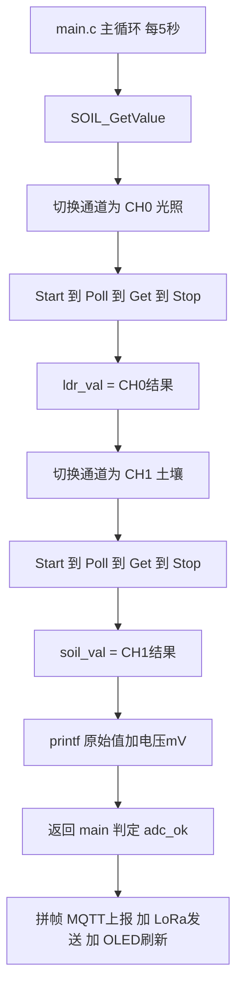

## 产品概述

STM32F103 农业环境监测终端的 ADC 采集功能修复。当前光照（LDR）与土壤湿度（SOIL）两路 ADC 采集结果完全相同且数值不随光照变化，导致环境监测数据失效。

## 核心功能

1. **修复两路 ADC 读到同一通道的缺陷**：使光照（CH0/PA0）与土壤湿度（CH1/PA1）能够分别正确采集，光照强度变化时读数随之明显变化
2. **回退无效的扫描模式配置**：移除在 STM32F103C8 上不生效的 EOCS 位操作，避免误用扫描模式非 DMA 读取
3. **增强调试可观测性**：串口输出两路原始 ADC 值及换算电压值（mV），便于验证传感器是否正常工作
4. **消除主循环阻塞**：移除采集函数内的 1 秒延时，避免影响 LoRa 中断事件轮询
5. **全量编译验证**：用 clean + build 方式确认修改后工程编译无误

## 技术栈

- **固件**：STM32F103C8（中密度器件，20KB RAM / 64KB Flash）+ HAL 库，CubeMX 生成骨架，Keil MDK-ARM（ARMCC V5.06u6）编译
- **采集**：ADC1 轮询方式（非 DMA、非中断），2 路模拟量（PA0 光照 / PA1 土壤湿度）
- **时钟**：ADC 时钟 = PCLK2/6 = 12MHz，单次转换时间约 21μs（239.5 周期采样）
- **调试输出**：printf 经 USART1（fputc 重定向）

## 实现方案

### 根因分析

STM32F103C8 属中密度（Medium-density）器件，**ADC_CR2 的 bit10（EOCS）未生效**，扫描模式下 EOC 只在**整个转换序列结束时**置位，而非每个通道转换结束。因此 `SOIL_GetValue()` 中：

1. 第一次 `PollForConversion` 等到 CH0→CH1 全部转换完，ADC_DR 中是**最后一个转换结果（rank2 = CH1 = 土壤）**
2. `ldr_val = HAL_ADC_GetValue()` 实际读到的是**土壤值** → 光照变化对它毫无影响
3. 读 DR 后 EOC 被清除，第二次 `PollForConversion` 因无新转换而**超时返回 HAL_TIMEOUT**，代码未检查返回值
4. `soil_val = HAL_ADC_GetValue()` 读到 DR 中的旧值 → **与 ldr_val 完全相同**

这与"soil 与 LDR 数值一样、光照无影响"的现象完全吻合。

### 修复策略

**采用单通道切换采集**（用户已选定）：每次采集前用 `HAL_ADC_ConfigChannel()` 切换通道，再执行 `Start → Poll → Get → Stop`。

**关键决策与权衡**：

| 决策 | 理由 |
| --- | --- |
| 单通道切换 vs DMA 扫描 | 仅 2 路通道、5 秒采集一次，DMA 无性能收益；单通道切换不依赖 EOCS/DMA，F1 全系列 100% 可靠，改动范围最小（仅 `soil.c` + `adc.c`） |
| 保留 239.5 周期采样时间 | 光敏电阻与土壤探头属高输出阻抗信号源，长采样时间可显著提升精度（原 1.5 周期严重不足） |
| 超时 1ms → 10ms | 单次转换仅需约 21μs，10ms 提供充足余量，避免边界情况下误判超时 |
| 移除 `HAL_Delay(1000)` | 该函数内 1 秒阻塞会拖慢主循环，影响 `LLCC68_IrqProcess()` 对 DIO1 事件的轮询；采集节奏已由 main 的 5 秒软定时控制 |
| 增加电压值（mV）输出 | 4025 接近满量程，需判断是传感器正常输出还是接线/供电异常，电压值比原始码值更直观 |


### 性能与可靠性

- 单次 `SOIL_GetValue()` 耗时约 42μs（两路转换）+ 通道配置开销，对 5 秒周期主循环影响可忽略
- 移除 1 秒阻塞后，主循环可保持高频轮询 LoRa 中断事件，发送响应更及时
- 每次采集前重新配置通道，避免多通道序列状态残留，具备幂等性

## 实现备注（执行细节）

- **函数接口保持不变**：`void SOIL_GetValue(void)`，全局变量 `soil_val` / `ldr_val` 及 `soil.h` 中的 extern 声明保持原样，**main.c 无需任何改动**
- **adc.c 位于 CubeMX 生成区**：`ScanConvMode` / `NbrOfConversion` 必须在 `HAL_ADC_Init()` 前生效，无法移入 USER CODE 区块；需在代码注释中写明"中密度 F1 不支持 EOCS，勿改回扫描模式"，避免日后 CubeMX 重新生成或人工误改回退
- **不要重复定义回调**：`HAL_ADC_ConvCpltCallback` 等 ADC 回调当前无冲突，本次改动不涉及中断，无需添加
- **校准（可选）**：F1 建议上电后执行一次 `HAL_ADCEx_Calibration_Start(&hadc1)` 消除约 ±5 LSB 偏移；实施时先确认该函数在当前 HAL 版本头文件 `stm32f1xx_hal_adc_ex.h` 中可用，若不可用则跳过
- **编译验证注意事项**（上一轮实测经验）：
- UV4 在**无文件需重编时不写 `-o` 日志文件**，必须先 `-c` clean 才能保证生成完整日志
- 读日志前 `Start-Sleep 5~8` 秒，UV4 写日志有延迟（曾误读到不完整日志）
- 基准值：Code=28648 RO-data=3148 RW-data=108 ZI-data=9940，目标 `0 Error(s)`
- 验证完毕删除临时日志文件

## 架构设计

改动集中在采集层（`soil.c`）与初始化层（`adc.c`），业务编排层（`main.c`）零改动：



## 目录结构

```
d:/MCU/STM32_PROJECT/
└── Core/
    ├── Src/
    │   ├── soil.c     # [MODIFY] 核心修复：SOIL_GetValue 改为单通道切换采集。
    │   │              #   1) 采集光照：ADC_CHANNEL_0(PA0) 配置后 Start 到 Poll(10ms) 到 Get 到 Stop
    │   │              #   2) 采集土壤：ADC_CHANNEL_1(PA1) 配置后 Start 到 Poll(10ms) 到 Get 到 Stop
    │   │              #   3) 移除末尾 HAL_Delay(1000)，避免阻塞主循环影响 LoRa 轮询
    │   │              #   4) printf 增加电压换算：ldr=%d(%.0fmV) soil=%d(%.0fmV)
    │   │              #   5) 保持 void SOIL_GetValue(void) 接口与 soil_val/ldr_val 全局变量不变
    │   └── adc.c      # [MODIFY] 回退为单通道配置：
    │                  #   1) ScanConvMode 改回 ADC_SCAN_DISABLE
    │                  #   2) NbrOfConversion 改回 1
    │                  #   3) 删除 CH1(PA1) 的 Rank2 通道配置，仅保留 CH0 默认初始化
    │                  #   4) 删除 USER CODE ADC1_Init 2 中无效的 EOCS 位设置并加警示注释
    │                  #   5) 保留 SamplingTime = ADC_SAMPLETIME_239CYCLES_5
    │                  #   6) 可选：末尾调用 HAL_ADCEx_Calibration_Start(&hadc1) 上电校准一次
    └── Inc/
        └── soil.h     # [保持不变] 已含 extern uint16_t soil_val/ldr_val 声明
```

## 关键代码结构

`soil.c` 改造后的实现契约（接口与全局变量签名不变）：

```c
/* 采集光照(CH0/PA0)与土壤湿度(CH1/PA1)，结果存入全局变量 ldr_val / soil_val
   采用单通道切换：F1 中密度器件 EOCS 位无效，扫描模式非 DMA 无法逐个读取多通道
   注：单次转换约 21μs，10ms 超时余量充足 */
void SOIL_GetValue(void);

extern uint16_t ldr_val;    // 光照 ADC 原始值 0~4095
extern uint16_t soil_val;   // 土壤湿度 ADC 原始值 0~4095
```

通道切换的核心调用序列（每次采集均执行，Rank 恒为 `ADC_REGULAR_RANK_1`）：

```c
ADC_ChannelConfTypeDef sConfig = {0};
sConfig.Channel      = ADC_CHANNEL_0;                  // 或 ADC_CHANNEL_1
sConfig.Rank         = ADC_REGULAR_RANK_1;
sConfig.SamplingTime = ADC_SAMPLETIME_239CYCLES_5;
HAL_ADC_ConfigChannel(&hadc1, &sConfig);
HAL_ADC_Start(&hadc1);
HAL_ADC_PollForConversion(&hadc1, 10);                 // 超时 10ms
value = HAL_ADC_GetValue(&hadc1);
HAL_ADC_Stop(&hadc1);
```

## 硬件排查指引（修复后由用户实测）

4025 ≈ 3.24V 接近满量程，修复代码后仍需验证传感器本身：

1. **模块引脚**：光敏模块常同时具备 AO（模拟）与 DO（数字）两组排针，必须接 **AO → PA0**；误接 DO 则读数只会是 0 或 4095
2. **光照响应**：手电筒直射光敏电阻，读数应大幅下降；完全遮住应上升接近 4095
3. **土壤响应**：探头干燥时输出高（接近 VCC，符合当前 4025 现象），插入湿土或水中应明显下降
4. **供电**：模块 VCC 必须接 **3.3V**，接 5V 会烧毁 ADC 引脚且读数恒为 4095
5. **接线顺序**：LDR → PA0、SOIL → PA1；若两路接反，修复后语义相反，交换 `ADC_CHANNEL_0/1` 即可
6. **故障判据**：读数恒为 0 或恒为 4095 且完全不变化，说明 AO 未接、模块未供电或引脚悬空