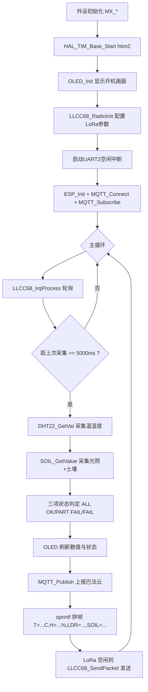

## 产品概述

STM32F103 农业环境监测终端固件：在 main 函数中编排已封装的 DHT22、LDR、土壤湿度、OLED、MQTT（巴法云）、LoRa 模块，完成环境数据采集、本地状态显示、云端上报与 LoRa 无线传输。

## 核心功能

1. **环境采集**：DHT22 空气温湿度、LDR 光照（ADC CH0）、土壤湿度（ADC CH1），统一 5 秒一轮
2. **OLED 英文显示**：温度/湿度/光照/土壤实时数值、MQTT 连接状态、总状态（`ALL OK` / `PART FAIL` / `FAIL`）
3. **巴法云 MQTT**：ESP8266 连热点与巴法云服务器、MQTT 连接（clientid 用私钥）、订阅主题、周期性上报环境数据
4. **LoRa 传输**：以键值对带单位格式 `T=25.6C,H=60.2%,LDR=1200,SOIL=3400` 非阻塞发送采集到的环境数据
5. **阻断问题修复**：ADC 双通道（否则土壤湿度读到的是光照值）、UART2 空闲中断（否则 MQTT 无响应）、mqtt.h 函数声明、LoRa 死循环改造为非阻塞、main.c 野指针

## 技术栈

- **固件**：STM32F103 + HAL 库，CubeMX 生成骨架（改动写在 USER CODE 区块），Keil MDK-ARM（ARMCC）编译
- **通信**：ESP8266 AT 指令（USART2，空闲中断接收）+ MQTT 3.1.1 裸协议（巴法云 9501 端口）；LLCC68 LoRa（SPI1 + Semtech radio 驱动）
- **显示**：IIC OLED 128x64（PB6/PB7 软件 IIC，ASCII 字库）
- **传感器**：DHT22（PC15 单总线，TIM2 微秒延时）、光照/土壤（ADC1 CH0=PA0 / CH1=PA1）

## 实现方案

**总体策略**：保持"各模块独立封装"现状，仅做最小必要修复，把业务编排逻辑集中在 `main.c` 的 USER CODE 区域。主循环采用 `HAL_GetTick()` 软定时实现 5 秒周期，全程非阻塞，高频轮询 LoRa 中断处理。

**关键技术决策**：

1. **UART2 空闲中断启动位置放 main.c**：`wifi_rxtemp` 定义在 `mqtt.c`、`mqtt.h` 已 extern 声明，在 `main.c` 的 `USER CODE 2` 调用 `HAL_UARTEx_ReceiveToIdle_IT(&huart2, wifi_rxtemp, BUFFERSIZE)` 即可，**无需改动 `usart.c`**，既满足 CubeMX 重生成安全，又避免跨文件 extern 污染。
2. **ADC 修复方式**：改为扫描模式（`ScanConvMode=ENABLE`、`NbrOfConversion=2`、CH0→Rank1、CH1→Rank2，采样时间改 239.5 cycles 提精度）。修复后 `SOIL_GetValue()` 现有的 `Start→Poll→Get(ldr)→Poll→Get(soil)→Stop` 写法恰好是正确用法，**soil.c 无需改动**。
3. **光照数据取自 soil.c 全局变量**：`ldr.c` 的 `ldr_val` 是局部变量无法外传，故弃用 `LDR_GetValue()`，统一用 `SOIL_GetValue()` 一次采集两路，通过 `soil.h` 新增的 `extern` 声明取 `ldr_val`/`soil_val`。
4. **LoRa 去阻塞**：从 `ExampleLLCC68SendDemo()` 抽出初始化与发送部分，新增 `LLCC68_RadioInit / LLCC68_SendPacket / LLCC68_IrqProcess` 三个接口，用 `volatile` 标志 `loraTxDone` 控制发完再发下一包；`LLCC68OnTxDone` 中**不再自动重发**，改由 main 每 5 秒触发，避免与业务周期冲突。
5. **状态判定**：`dht_ok`（DHT22 返回值）、`adc_ok`（`ldr_val`/`soil_val` 在 1~4094 合理区间）、`mqtt_ok`（连接成功且本轮 Publish 成功）；三项全真显示 `ALL OK`，全假显示 `FAIL`，否则 `PART FAIL`。

**性能与可靠性**：

- 主循环每圈调用 `LLCC68_IrqProcess()`（无长延时），5 秒到点才执行采集+上报，LoRa 事件响应延迟 ≤ 主循环单圈耗时
- LoRa 负载约 40 字节，SF9/BW125 下空中时间约 100~200ms，5 秒间隔余量充足
- 采集阶段含 `HAL_Delay(1000)`，安排在 LoRa 发送之前，发送后主循环保持轮询，不影响 TxDone 处理
- ESP8266 各步骤带 10s 超时，`ESP_Init()` 整体可能耗时 5~15 秒，仅在上电初始化执行一次

## 架构设计



## 实现备注（执行细节）

- **OLED 行宽限制**：`OLED_ShowString` 每字符 8px，`x>120` 自动换行，每行必须 ≤16 字符（如 `T:25.6C H:60.2%` / `L:1200 S:3400` / `MQTT:OK` / `STATUS:ALL OK`），否则错行
- **禁止重复定义**：`HAL_GPIO_EXTI_Callback`、`HAL_TIM_PeriodElapsedCallback` 已被 `LLCC68STM32F103-board.c` 占用；`HAL_UARTEx_RxEventCallback` 已被 `mqtt.c` 占用
- **引脚以 main.h 为准**：`project_config.h` 里的 `RADIO_*` 引脚（nRESET=PB14、DIO1=PB1、BUSY=PA0）是遗留未使用的宏，不要据此改硬件
- **野指针必修**：`main.c` 的 `float *temp=NULL` 会导致 HardFault，改为 `float temp=0.0f, humi=0.0f` 并传址
- **MQTT 重连隐患**：`MQTT_Connect/Subscribe/Publish` 内 `static uint32_t cnt` 不清零，重复调用报文会累积错乱，需改为局部变量并在函数入口清零
- **栈空间**：`ESP_Init()` 内有 512 字节局部 `buf`，需核对 `startup_stm32f103xe.s` 的 `Stack_Size`（默认 0x400 偏小，建议调至 0x800）
- **浮点数打印**：`printf("%.1f")` 需 Keil 勾选 `Use MicroLIB`，若串口输出异常需检查该选项
- **Keil 工程**：新增的 5 个 LoRa `.c` 文件尚未加入工程，编译前必须手动添加，否则链接报错

## 目录结构

```
d:/MCU/STM32_PROJECT/
├── Core/
│   ├── Inc/
│   │   ├── mqtt.h                    # [MODIFY] 补充 ESP_Init/MQTT_Connect/MQTT_Subscribe/MQTT_Publish 等函数声明，供 main.c 调用
│   │   ├── soil.h                    # [MODIFY] 新增 extern uint16_t soil_val; extern uint16_t ldr_val; 供 main 取 ADC 数据
│   │   └── llcc68_example_send.h     # [MODIFY] 声明 LLCC68_RadioInit/LLCC68_SendPacket/LLCC68_IrqProcess 非阻塞接口
│   └── Src/
│       ├── main.c                    # [MODIFY] 核心编排：修复野指针、启动UART2空闲中断、OLED/LoRa/MQTT初始化、5秒周期采集与上报主循环
│       ├── adc.c                     # [MODIFY] USER CODE 区块内将 ADC1 改为扫描模式双通道（CH0 Rank1 + CH1 Rank2），采样时间改239.5周期
│       ├── llcc68_example_send.c     # [MODIFY] 抽出 Radio 初始化为非阻塞 LLCC68_RadioInit，新增 LLCC68_SendPacket/LLCC68_IrqProcess，增加 loraTxDone 标志
│       └── mqtt.c                    # [MODIFY] 修复 MQTT_Connect/Subscribe/Publish 中 static cnt 累积 bug，改为局部清零以支持断线重连
└── MDK-ARM/
    └── STM32_PROJECT.uvprojx         # [CHECK] 核对并提示用户添加 llcc68.c、LLCC68STM32F103-board.c、llcc68_example_recive.c、llcc68_example_send.c、radio.c
```

## 关键代码结构

LoRa 非阻塞接口契约（新增于 `llcc68_example_send.h`，实现在 `llcc68_example_send.c`）：

```c
// 初始化 Radio：注册事件回调 + Radio.Init + SetChannel + SetTxConfig，不进入死循环
void     LLCC68_RadioInit(void);
// 发送一包数据；上一包未发完返回 0，成功启动发送返回 1
uint8_t  LLCC68_SendPacket(uint8_t *data, uint8_t len);
// 主循环高频调用，处理 DIO1 中断事件（内部调 Radio.IrqProcess）
void     LLCC68_IrqProcess(void);
// 发送完成标志（volatile），TxDone/TxTimeout 回调中置 1，发送前清 0
extern volatile uint8_t loraTxDone;
```

main.c 数据帧拼接格式（MQTT 与 LoRa 共用同一 payload，约 40 字节）：

```c
char payload[64];
sprintf(payload, "T=%.1fC,H=%.1f%%,LDR=%d,SOIL=%d", temp, humi, ldr_val, soil_val);
```

## Agent Extensions

### SubAgent

- **code-explorer**
- Purpose：检索 `MDK-ARM/STM32_PROJECT.uvprojx` 工程文件，核实已加入编译的 `.c` 文件清单（确认新增的 5 个 LoRa 文件和 `MDK-ARM/dht22.c` 是否已在工程中）
- Expected outcome：输出工程当前参与编译的源文件完整列表，明确指出缺失文件，避免编译时出现未定义符号链接错误